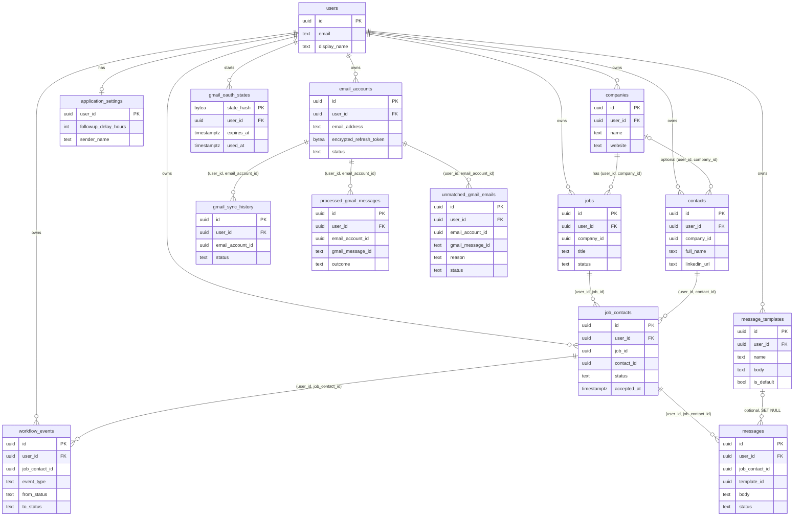

# Database schema

Migrations: `000001_init` (core), `000002_gmail` (Gmail), `000003_followups` (templates, messages, settings).

## ER diagram

## Tenancy guarantees

- Every user-owned table has `user_id UUID NOT NULL REFERENCES users(id)`.
- Every parent table has `UNIQUE (user_id, id)`.
- Every relationship is a composite foreign key `(user_id, parent_id) -> parent(user_id, id)`: a child can never reference another user's row, even if the application is wrong.
- Every SQL statement filters by `user_id`, including joins (`ON c.user_id = j.user_id AND c.id = j.company_id`).
- RLS is not enabled but the schema is compatible with `USING (user_id = auth.uid())` policies.

## Uniqueness and constraints

| Constraint | Meaning |
| --- | --- |
| `companies_user_name_uidx` | company names unique per user, case-insensitive |
| `contacts_user_linkedin_uidx` | one contact per LinkedIn URL per user (partial, URL not null) |
| `job_contacts_user_job_contact_key` | a contact can be linked to a job once |
| `*_status_check` | status values restricted to the allowed set |
| `gmail_sync_one_running_uidx` | one RUNNING sync per account (concurrency guard) |
| `processed_gmail_messages_user_message_key` | a Gmail message id is processed once per user (idempotency) |
| `unmatched_gmail_emails_user_message_key` | one review-queue row per Gmail message |
| `messages_one_draft_uidx` | at most one active DRAFT per job contact (idempotent generation) |
| `message_templates_one_default_uidx` | at most one default template per user |
| `email_accounts_user_address_key` | one stored account per mailbox per user |

## Delete behavior

| Delete | Effect |
| --- | --- |
| company with jobs or contacts | blocked (409) |
| job | cascades to its job_contacts and their events |
| contact | cascades to its job_contacts and their events |
| job_contact | cascades to its events |
| template | messages made from it are kept (`template_id` becomes NULL; PostgreSQL 15+) |
| email account | cascades to sync history, processed ledger and review queue |
| user | cascades to everything the user owns |

## Indexes

All list queries are served by `(user_id, ...)` indexes: `jobs(user_id, company_id)`, `jobs(user_id, created_at desc)`, `contacts(user_id, company_id)`, `job_contacts(user_id, status)`, `job_contacts(user_id, job_id)`, `workflow_events(user_id, created_at desc)`, and others in the migration.
